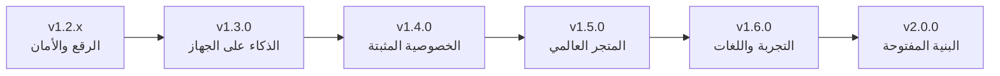
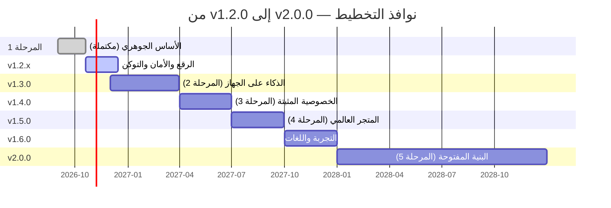

# خارطة الطريق — DRS Smart Keyboard (ROADMAP.md)

> الوثيقة الأم لتطوير المشروع وتحسينه. توحّد هذه الصفحة كل المراجع المتفرقة
> إلى «الخريطة الكبرى» (في ADR 0004/0005/0006 وARCHITECTURE وCOVERAGE
> وPENTEST_PROGRAM وGLOBAL_LAUNCH) في وثيقة واحدة معلنة، بحالة محدثة
> ومعايير إنجاز قابلة للفحص.
>
> - **الحالة عند التوثيق:** v1.2.0 «أبجديات الآلة والحساب» (أكتوبر 2026).
> - **إيقاع المراجعة:** ربع سنوية مع أول إصدار مستقر لكل ربع — أي انحراف
>   يُوثق بقرار ADR مستقل، فالخارطة التزام علني لا شعار.
> - **التواريخ نوافذ تخطيطية** تُراجع دوريًا، لا وعودًا تسويقية — عقيدة
>   المشروع في الأرقام الصادقة تنطبق على الجدول نفسه.

## 1) المبادئ الحاكمة (لا تُساوم في أي مرحلة)

1. **كل شيء على الجهاز.** الكتابة والتصحيح والاقتراح والذكاء كلها محلية.
   لا حساب، لا تسجيل دخول، لا إعلانات، ولا شبكة إلا حين يطلبها المستخدم
   يدويًا (تحديث، حزمة).
2. **لا تخمين ولا تلف.** عقد الأدوات الثابت: ما لا يفهمه المحرك يعود
   بايتًا ببايت — لا حرف بديل مُختلَق ولا إصلاح صامت.
3. **الأدلة قبل الوعود.** الخصوصية تُثبت تقنيًا (privacy canary في كل
   دفعة، اختبارات عقد الأذونات، إثبات TrafficStats حي) لا بالكلام.
4. **صفر أذونات زائدة.** خمسة أذونات مغلقة القائمة كلها بمبررات موثقة في
   تقرير الشفافية؛ أي إذن سادس = فشل بناء.
5. **أرقام صادقة بحدودها.** كل مؤشر يُوصف بما يقيس فعلًا ومتى لا يقيس —
   مثل وصف `crashRatePerSession` كمؤشر مختبرين لا مؤشر سوق.
6. **التوثيق جزء من المنتج.** لا ميزة تُعلن مكتملة قبل أن تدخل دليل
   المستخدم وCHANGELOG والسلاسل عربيًا وإنجليزيًا.

## 2) أين نحن الآن (لقطة v1.2.0 — أكتوبر 2026)

| المحور | الحالة المثبتة |
|---|---|
| الإصدارات | ثلاثة إصدارات رسمية: 1.0.0 (الإطلاق)، 1.1.0 (الشفافية والتعلم)، 1.2.0 (أبجديات الآلة والحساب) — كل منها بـ11 أصلاً (APK + AAB + 8 حزم flex + SHA256SUMS) |
| الكتالوج | 82 أداة نصية (الرموز ‎-682..-601) بأزواج مرآوية وعقد إطلاق مضمون لذكاء البلاطات |
| الاختبارات | 1950 اختبارًا أخضر عبر 139 ملفًا — صفر فشل، صفر تخطٍّ، مع بوابة Kover في CI |
| الأمان | privacy canary لكل دفعة، CodeQL وgitleaks مجدولان، تدقيق بنيوي `audit_text_tools.py`، توقيع ed25519 لكتالوج الحزم (ADR 0007) |
| الخصوصية | 5 أذونات فقط، الوضع المطلق بضغطة، تقرير شفافية أول منشور، GDPR موثق |
| التوزيع | GitHub Releases + Pages (الموقع والدليلان) + مركز تحديث داخلي + بيتا أسبوعية آلية |
| المفاتيح | دوران مفتاح التوقيع في 1.2.0 (الترقيات الموضعية مضمونة من 1.2.0 صعودًا) |
| التوثيق | دليلا مستخدم موحدان (2.0.0)، 10 قرارات ADR، سياسة إصدار وإصدارات أمنية ربع سنوية، برنامج اختراق جاهز للتشغيل |

## 3) هيكل المراحل الموحد (التأسيس الرسمي)

المراجع السابقة كانت تذكر المراحل مبعثرةً؛ هذه هي البنية المعتمدة:

| المرحلة | الاسم | النطاق | الحالة | الدليل |
|---|---|---|---|---|
| 1 | **الأساس الجوهري** | بنية موحدة، اختبارات وبوابات جودة، لوحة مؤشرات بلا تتبع، تقرير شفافية أولي | ✅ **مكتملة عمليًا** | 1950 اختبارًا، CI أخضر، QUALITY_DASHBOARD، العدد الأول للتقرير |
| 2 | **الذكاء على الجهاز** | محرك تصحيح واقتراح بنماذج خفيفة مكمّمة، توقع الكلمة التالية العربية، ذكاء بلاطات أعمق | 🔶 **قيد التنفيذ** | ADR 0005 (المهام 8–14) منفذة أساسًا — ذراعا L1 وL2 من سلّم الذكاء مكتملتان بعقود مغلقة ([SMART_FEATURES_ROADMAP](SMART_FEATURES_ROADMAP.md) — الدفعتان 14 و15) |
| 3 | **الخصوصية المثبتة والثقة** | حظر شبكي مُثبت تقنيًا، تقرير شفافية نصف سنوي، اختراق خارجي، إيقاع أمني ربع سنوي | 🔶 **جزئية** | التقرير الأول منشور، الإيقاع معلن — الحظر المثبت الدائم والاختراق الخارجي باقيان |
| 4 | **التوزيع العالمي** | Google Play + قنوات مباشرة، بيانات أمان المتجر، بيتا علنية | ⬜ **جاهزة التنفيذ** | GLOBAL_LAUNCH (M3.5) بخطوات مملوكة ومدققة |
| 5 | **البنية المفتوحة** | خادم مزامنة أعمى E2E، قرار فتح المصدر، دراسة جمع تطوعي opt-in بADR، تمويل تدقيق خارجي | ⬜ **مخططة** (نافذة 2028) | ADR 0006 (صيغة الحاوية جاهزة)، ADR 0004 §بعد فتح المصدر |
| 6 | **الذكاء الجيل الثاني** | فهم سياق أعمق على الجهاز، اقتراح عبارات، ذكاء الحزم | ⬜ **مخططة** | ADR 0005 §«الذكاء الجيل الثاني» — بعد استقرار الجيل الأول |

## 4) سلّم الإصدارات (ثيمة لكل إصدار وبوابة خروج)

| الإصدار | النافذة | الثيمة | أبرز المخرجات | بوابة الخروج (لا يُوسم قبل استيفائها) |
|---|---|---|---|---|
| **v1.2.x** | الآن | الرقع والأمان | إصلاحات تراكمية، تزامن الأدلة مع كل إصدار، إبطال توكن CI واسع الصلاحيات واستبداله برمز دقيق النطاق، نقل بذرة الناشر ed25519 إلى تخزين بارد | CI أخضر + صفر أعطال حرجة + فحص أسرار خارجي |
| **v1.3.0** | Q1 2027 | الذكاء على الجهاز | محرك تصحيح إملائي عربي مكمَّم (ADR 0005 مهام 8–11)، توقع الكلمة التالية بنماذج خفيفة، توسيع ذكاء البلاطات، أوامر صوتية محلية أعمق | اختبارات A/B داخلية تفوق خط التصحيح الحالي + أثر ذاكرة ونطاق زمن المقترح ضمن الميزانيات + نموذج محلي بلا أي تنزيل سحابي |
| **v1.4.0** | Q2 2027 | الخصوصية المثبتة | «الوضع المطلق» بإثبات حظر شبكي دائم (عدّادات TrafficStats حية بالواجهة)، اختبارات عقد أذونات موسعة، جولة تدقيق MASVS داخلي كامل، تقرير الشفافية العدد الثاني | إثبات حي في الواجهة + اجتياز MASVS-PRIVACY داخليًا + الإيقاع الأمني الربع سنوي منفذ مرة كاملة |
| **v1.5.0** | Q3 2027 | المتجر العالمي | Google Play Console + AAB موقع، إعلان بيانات الأمان «لا نجمع شيئًا»، إطلاق عالمي، بيتا أسبوعية علنية معلنة | `ci/release_checklist.py` 11/11 + قبول المتجر + لوائح عربي/إنجليزي منشورة |
| **v1.6.0** | Q4 2027 | التجربة واللغات | محرر سمات مرئي، إمكانية وصول (TalkBack كامل على كل الشاشات)، onboarding تفاعلي، توسيع لغات RTL (فارسية/أردو) فوق الأساس العربي | تدقيق وصول موثق + حزم لغوية بعقود الأدوات نفسها |
| **v2.0.0** | 2028 | البنية المفتوحة | خادم مزامنة أعمى E2E (خازن بايتات لا يرى شيئًا سوى الحاوية الموقعة)، قرار فتح نواة المحرك بADR، دراسة جمع اختياري opt-in، بدء الجيل الثاني (المرحلة 6) | ADR مستقل لكل قرار + تدقيق خارجي ممول + حاوية المزامنة مقاومة العبث مثبتة بالاختبارات |

## 5) الأعمدة العشرة (تفصيل التطوير والتحسين)

### أ) الكتالوج النصي (المنتج الظاهر)
- **الوضع:** 82 أداة بأزواج مرآوية (روابط، Base64، مورس، Hex) وزوج حسابي ومنظفات وفاحص وحاصد — وعقد «لا تخمين ولا تلف» مثبت بالاختبارات.
- **القادم:** أزواج تقويم (هجري↔ميلادي موجود، يُعمَّق)، أزواج Unicode (رموز↔أسماء)، أدوات JSON صغيرة (تنسيق/تحقق)، توسيع فئات الوحدات (وقود/حذاء؟ بمصادر موثقة فقط)، وكل زوج جديد بسببه المغلق في ذكاء البلاطات.
- **معيار الإنجاز:** كل أداة جديدة بمحاكاة بايثون قبل البناء + عقد مدخلات معادية + تدقيق بنيوي أخضر — لا استثناء.

### ب) الذكاء على الجهاز (المرحلة 2 — أولوية قصوى)
- **الوضع:** ذكاء بلاطات قواعدي بعقود إطلاق مضمونة، إملاء صوتي على الجهاز، والمحرك المكمَّم (ADR 0005 م8–11) عند معيار المستوى: ميزانية مكمَّمة واعية مثبتة (min(الحقيقي، الميزانية))، مسح مُدلَّل بالطول حتمي كليًا، ميزان تشكيل حي، وذراع الأمان المحلي L1 — الدليل في [SMART_FEATURES_ROADMAP](SMART_FEATURES_ROADMAP.md).
- **القادم:** توقع الكلمة التالية الأعمق (L3) ودمجه بأسباب البلاطات دون كسر عقود الإطلاق، أوامر صوتية محلية أعمق، والقطع في إصدار v1.3.0 بعد المراجعة الربع سنوية.
- **معيار الإنجاز:** تفوق قياسٍ على مجموعات أخطاء كتابة حقيقية (مثبت: المكمّم المندمج 100% مقابل 44% لخط delete-1 على المرجعية الحقيقية)، بلا أي حزمة سحابية وبلا تراجع في زمن المفتاح p95.

### ج) الخصوصية المثبتة والأمان (المرحلة 3)
- **الوضع:** canary لكل دفعة، 5 أذونات، وضع مطلق متاح، إيقاع أمني ربع سنوي معلن، برنامج اختراق جاهز.
- **القادم:** إثبات حظر شبكي دائم مرئي (عدّادات بايت صادرة/واردة حية)، اختبارات عقد أذونات إضافية، جولة MASVS داخلي شاملة، اختراق خارجي عند تمويل المرحلة 5 (نافذة 2028 وفق PENTEST_PROGRAM).
- **معيار الإنجاز:** إثبات حي في الواجهة يمكن أي مستخدم فحصه بنفسه — والدليل جزء من تقرير الشفافية.

### د) الجودة والاختبارات
- **الوضع:** 1978 اختبارًا، Kover في CI، ميزانيات أداء (نافذة 256 لزمن المفتاح)، بوابة انحدار حجم APK.
- **القادم:** رفع بوابة التغطية تدريجيًا على مسار ≥85% (القياس أولًا ثم البوابة — القاعدة في COVERAGE.md)، اختبارات خصائص للمحللات (fuzz خفيف على مراكز الأدوات)، بوابة ذاكرة للنماذج الجديدة، تقرير تغطية ربع سنوي في صفحة COVERAGE.
- **معيار الإنجاز:** كل دفعة لا تكسر بواباتها، والبوابة تُرفع فقط بعد قياس مستقر لدورتين.

### هـ) التوزيع العالمي (المرحلة 4)
- **الوضع:** GitHub Releases + Pages + مركز تحديث داخلي + بيتا أسبوعية آلية؛ خطوات المتجر موثقة مملوكة.
- **القادم:** تنفيذ GLOBAL_LAUNCH فعلًا: Play Console، AAB موقع بالمفتاح الجديد، لوائح عربي/إنجليزي، إعلان «لا نجمع بيانات»، ثم تقييم قنوات إضافية (F-Droid عبر مستودع ذاتي، متاجر إقليمية) بعد استقرار القناة الأولى.
- **معيار الإنجاز:** إصدار واحد متزامن عبر كل القنوات بversionCode واحد رتيب — لا انحراف بين القنوات.

### و) التجربة والتصميم
- **الوضع:** تصميم 2030 موحد، 8 حزم flex موقعة، سِمات مدمجة، لوحات ذكية سياقية.
- **القادم:** محرر سمات داخل التطبيق بمعاينة حية، TalkBack كامل، onboarding من 3 خطوات، لمسات haptic دقيقة قابلة للتخصيص، لقطات شاشة محدثة في docs/SCREENSHOTS مع كل إصدار كبير.
- **معيار الإنجاز:** لا شاشة جديدة تُدمج قبل اختبار وصولها وتجربتها بحجمَي خط.

### ز) اللغات والتوطين
- **الوضع:** عربية أولًا بعمق (ذكاء عربي على الجهاز) وإنجليزية كاملة، حزم لغة بنظام الامتدادات الموقعة.
- **القادم:** فارسية وأردو (RTL أصيل يشترك بالأساس العربي)، تخطيطات لاتينية موسعة، وكل لغة بعقود الأدوات نفسها (لا تخمين ولا تلف بلغتها أيضًا).
- **معيار الإنجاز:** كل لغة جديدة تجتاز 100% من اختبارات العقود المشتركة + مراجعة ناطِق أصلي.

### ح) التوثيق والمجتمع والشفافية
- **الوضع:** دليلان موحدان (2.0.0)، تقرير شفافية أول، SUPPORT وقنوات مبلغة، 10 ADRs.
- **القادم:** تقرير شفافية نصف سنوي بلا انقطاع (العدد 2 مع v1.4.0)، تحديث الدليلين مع كل إصدار (الدرس المنفذ في 1.2.0)، فهرس أسئلة شائعة من بلاغات الدعم الحقيقية، دليل مساهمين متى فُتحت المساهمة.
- **معيار الإنجاز:** أي مرجع إصدار قديم في صفحة عامة = عيب بنيوي يُصلح فورًا (كومِت 6ef5a42 نموذجًا).

### ط) البنية الذاتية والمزامنة (المرحلة 5)
- **الوضع:** صيغة حاوية مزامنة E2E موقعة جاهزة (ADR 0006) بلا خادم عمدًا.
- **القادم (نافذة 2028):** خادم خازن بايتات أعمى ذاتي الاستضافة، قرار فتح المصدر بADR مستقل، دراسة جمع opt-in بADR مستقل — كلها مرتبطة بتمويل التدقيق الخارجي.
- **معيار الإنجاز:** الخادم لا يملك مفتاح فك الحاوية بنيويًا (يُثبت بالكود والاختبار لا بالتصميم وحده).

### ي) الحوكمة والتشغيل
- **الوضع:** سياسة إصدارات وADR، إيقاع أمني ربع سنوي، بيتا آلية، حرس هوية git.
- **القادم:** مراجعة هذه الخارطة ربع سنويًا، تقليل نطاق رموز CI إلى الحد الأدنى (بيئة/توقيع محصور)، نسخ احتياطي بارد موثق للمفاتيح (درس فقد keystore المدفوع في 1.2.0)، runbook إصدار مختبر من طرف إلى طرف مرة كل نصف سنة.
- **معيار الإنجاز:** أي عملية حوكمة حرجة قابلة لإعادة التنفيذ من التوثيق وحده بلا معرفة شفهية.

## 6) الجدول الزمني (نوافذ تخطيطية)

## 7) مؤشرات النجاح الكلية

| المؤشر | خط الأساس (v1.2.0) | الهدف | كيف يُقاس |
|---|---|---|---|
| خلو الأعطال (مختبرون) | قيد التراكم | ≥ 99.5% جلسات | `crashRatePerSession()` محليًا — وصفه الصادق: مؤشر مختبرين لا سوق |
| زمن CI الكامل | < 10 دقائق | الحفاظ < 10 دقائق | سير android.yml |
| التغطية (مسارات DRS) | خط Kover المثبت | ≥ 85% تدريجيًا | تقرير Kover في CI (COVERAGE.md) |
| حجم APK release | 11.5MB | رقابة انحدار ±5% | مقارنة SHA256SUMS مع كل إصدار |
| زمن معالجة المفتاح p95 | ضمن الميزانية | لا تراجع مع الذكاء الجديد | نافذة DrsPerformance 256 |
| نطاق نموذج التصحيح | 0.81MB مقاسًا (ar.json المدمج) | < 15MB وأثر ذاكرة محدود | قياس كومة DrsPerformance قبل/بعد + التثبيت البنيوي في DrsL2QuantizedTests |
| الأذونات | 5 | 5 — لا تزيد أبدًا | canary + اختبار عقد المانيفست |
| تزامن المراجع العامة | تم (6ef5a42) | صفر مرجع قديم بعد كل إصدار | فحص قائمة §5-ح في الـrunbook |

## 8) المخاطر والتحوطات (دروس مدفوعة الثمن)

| الخطر | الدرس/الأثر | التحوط المعتمد |
|---|---|---|
| فقد مفاتيح التوقيع | حدث فعلًا — أجبر دورانًا في 1.2.0 وكسر الترقية الموضعية مرة واحدة | تخزين بارد موثق + إجراء استرجاع مكتوب + الترقيات المضمونة موعود لا يُعاد كسره |
| توكن واسع الصلاحيات في CI | كشف مؤقت — مُنصح بإبطاله مرارًا | استبدال برمز دقيق النطاق (contents:read + pages) في نافذة v1.2.x |
| عربة واحدة (مالك وحيد) | كل المعرفة معرضة للانقطاع | runbooks مكتوبة (إصدار/استرجاع/نشر) + ADRs شاملة + الدليلان محدثان |
| رفض أو تأخر المتجر | يعطل المرحلة 4 كاملة | قنوات مباشرة جاهزة الآن (Releases + مركز داخلي) فالمستخدم لا ينتظر المتجر |
| تضخم النماذج الذكية | يقتل زمن المفتاح والبطارية | ميزانيات حجم/ذاكرة/زمن معلنة + بوابة انحدار + نماذج مكمَّمة حصرًا |
| انجراف العقود مع السرعة | أداة جديدة تكسر «لا تخمين» | محاكاة بايثون إلزامية قبل البناء + التدقيق البنيوي + عقد المدخلات المعادية لكل أداة |
| مراجع إصدار قديمة علنية | ثقة المستخدم | بند runbook §5-ح + الدرس المنفذ في 1.2.0 |

## 9) ما لن نفعله أبدًا (Non-Goals — الهوية)

- **لا سحابة للكتابة:** لا حرف يغادر الجهاز في مسار الكتابة، مهما كانت المكافأة.
- **لا تتبع ولا تحليلات:** لا Crashlytics ولا أي SDK أعطال أو إحصاء سحابي — الأعطال تصدير يدوي يتقدمه المستخدم.
- **لا إعلانات ولا «مجاني بمقابل خفي»:** لا شبكات إعلانية داخل عملية IME أبدًا.
- **لا أذونات «لتحسين التجربة»:** القائمة الخمسة مغلقة؛ أي طلب إذن جديد يحتاج ADR وإلغاء إذن مقابل.
- **لا تخمين باسم الذكاء:** أي تصحيح أو اقتراح لا يصل عتبة الثقة المعلنة يصمت — لا نُظهر نصًا لم يطلبه المستخدم.
- **لا وعودًا بلا أدلة:** لا ميزة تُعلن قبل أن تجتاز بوابتها الموثقة.

## 10) حوكمة هذه الخارطة

1. **المراجعة:** ربع سنوية مع أول إصدار مستقر للربع — تُحدَّث §2 و§6 و§7 وحالات المراحل في §3 فقط، وكل تغيير أعمق يحتاج كومِتًا يشرح «لماذا».
2. **الانحراف:** أي تأخير أو إعادة ترتيب تُوثق في CHANGELOG لتلك النافذة + ADR عند تغيير بنية (لا مجرد مواعيد).
3. **الربط:** هذه الخارطة ملخص تنفيذي — التفاصيل التشغيلية تبقى في وثائقها (الجدول أدناه) وهذه الصفحة لا تكررها بل تحيل إليها.
4. **التحقق:** في كل مراجعة يُسأل سؤال واحد عن كل بند: «ما الدليل؟» — بلا دليل يعاد تصنيفه من «مكتمل» إلى «جاري».

## 11) فهرس الوثائق المرتبطة

| الوثيقة | ماذا تحكم |
|---|---|
| [ADR 0003](adr/0003-release-versioning-policy.md) + [RELEASE_POLICY](RELEASE_POLICY.md) | الترقيم والوسوم والبيتا الأسبوعية |
| [ADR 0004](adr/0004-crash-reporting-privacy.md) + [QUALITY_DASHBOARD](QUALITY_DASHBOARD.md) | الأعطال ومؤشرات الجودة بلا تتبع |
| [ADR 0005](adr/0005-on-device-ai-engine.md) | محرك الذكاء على الجهاز (المرحلتان 2 و6) |
| [ADR 0006](adr/0006-provable-privacy-e2e-sync.md) + [ADR 0007](adr/0007-ed25519-package-trust.md) | الخصوصية المثبتة والمزامنة وثقة الحزم |
| [COVERAGE](COVERAGE.md) | قاعدة وهدف التغطية وآلية Kover |
| [PENTEST_PROGRAM](PENTEST_PROGRAM.md) + [SECURITY_UPDATES](SECURITY_UPDATES.md) | الاختراق الخارجي والإيقاع الأمني |
| [GLOBAL_LAUNCH](GLOBAL_LAUNCH.md) | خطوات المتاجر المملوكة (المرحلة 4) |
| [TRANSPARENCY_REPORT](TRANSPARENCY_REPORT.md) + [GDPR_COMPLIANCE](GDPR_COMPLIANCE.md) | الشفافية النصف سنوية والامتثال |
| [CHANGELOG](../CHANGELOG.md) + [USER_GUIDE_AR](USER_GUIDE_AR.md) / [USER_GUIDE_EN](USER_GUIDE_EN.md) | سجل الإصدارات ودليل المستخدم |
