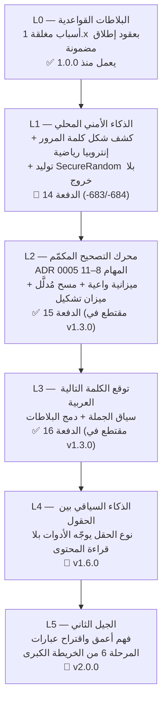

# خارطة الميزات الذكية — سلم الذكاء (SMART_FEATURES_ROADMAP.md)

> الوثيقة التنفيذية لذكاء DRS Smart Keyboard — تفصّل ما تبنيه الخريطة
> الكبرى ([ROADMAP](ROADMAP.md)) في محور «الذكاء على الجهاز» سلّمًا واحدًا
> قابلًا للفحص، من ذكاء البلاطات القواعدي اليوم إلى الجيل الثاني.
>
> **العقيدة الحاكمة للذكاء (لا تُخالف):**
> 1. **الذكاء يصمت حين لا يثق.** لا اقتراح بلا «عقد إطلاق مضمون» —
>    ما لا يُحلّ محليًا نتيجةً مؤكدة لا يُرشَّح أصلًا (ما لا يُفك لا يُرشَّح).
> 2. **لا تخمين ولا تلف.** كل أداة ذكية حتمية: ما لا يفهمه المحرك يعود
>    بايتًا ببايت — الذكاء توصية، والإطلاق بيد المستخدم وحده.
> 3. **كل الذكاء على الجهاز.** لا نموذج يُنزَّل من سحابة، لا محتوى حقل
>    يغادر الجهاز، ولا ذكاء إطلاقًا في حقول كلمات المرور أو الوضع
>    المطلق أو الوضع المتخفي (البوابة الصلبة في المحرر).
> 4. **سبب مغلق لكل ترشيح.** كل سبب يُرقَّم ويُوثَّق ويُختبر بالإيجاب
>    والسلب (نمط 1.9 → 1.12) — لا «ذكاء» بلا مرآة اختبار.

## سلم الذكاء L0 → L5

| المستوى | الثيمة | ما الذي يصبح ذكيًا؟ | أين يُقاس؟ |
|---|---|---|---|
| **L0** ✅ | البلاطات القواعدية | اللوحة تقترح الأداة الصحيحة من شكل النص — 12 سببًا مغلقًا بعقود إطلاق مختبرة إيجابًا وسلبًا | `DrsTileContextAdvisor` + اختباراته |
| **L1** 🚧 | الذكاء الأمني المحلي | الحقل يفهم أنه يحمل سرًا: قياس الإنتروبيا رياضيًا، كشف الأنماط الضعيفة بكتالوجات مغلقة، وتوليد كلمة قوية بـ`SecureRandom` — كلها بلا أي شبكة | `passwordStrength` / `generatePassword` |
| **L2** ✅ | التصحيح المكمَّم | محرك تصحيح إملائي عربي بنموذج خفيف مكمَّم — ميزانيات حجم (< 15MB) وزمن معلنة في KPIs. **مكتمل تقنيًا في الدفعة 15**: ميزانية واعية مثبتة (min(الحقيقي، الميزانية))، مسح مُدلَّل بالطول، ميزان تشكيل حي، وA/B حاسمة على مرجعية الأخطاء الحقيقية — قطع الإصدار في v1.3.0 | ADR 0005 المهام 8–11 + DrsL2QuantizedTests |
| **L3** ✅ | التوقع السياقي | توقع الكلمة التالية من سياق الجملة، ودمج توقعاته مع أسباب البلاطات دون كسر عقود الإطلاق. **مكتمل تقنيًا في الدفعة 16**: حد الجملة الحارس (كتالوج نهايات مغلق مرآةٌ مثبتة)، مسار البداية الجديدة (مفردات المستخدم + كتالوج الافتتاحيات)، سلسلة الترقيم المغلقة (ثماني حلقات حتمية)، والسبب البلاطي 1.13 بعقد الإطلاق المضمون — قطع الإصدار في v1.3.0 | `DrsSentenceContext` + `DrsL3SentenceContextTests` + المرجعية `check_l3_sentence.py` |
| **L4** 📅 v1.6.0 | الذكاء بين الحقول | نوع الحقل (من `EditorInfo` وحده) يرتّب الأدوات — وحقول الحماية تبقى صماء تمامًا (الخصوصية قبل الذكاء دائمًا) | `DrsFieldKind` + `DrsContextualRank` |
| **L5** 📅 v2.0.0 | الجيل الثاني | فهم أعمق للسياق واقتراح عبارات كاملة — كلها مولَّدة محليًا | المرحلة 6 + ADR مستقل |

## المبادئ التنفيذية لكل مستوى (نمط الدفعة المثبت)

1. **محاكاة بايثون قبل البناء** — كل التوقعات تُحسب وتُختبر خارج Kotlin أولًا
   (`scripts/check_*.py`)، والمحاكاة هي المرجع حين تختلف عن التوقع اليدوي.
2. **عقد مضمون لكل ترشيح** — السبب الجديد في `DrsTileContextAdvisor` يُختبر
   إيجابًا (ما يُرشَّح ولماذا) وسلبًا (ما يصمت ولماذا) في `DrsSmartTileTests`.
3. **كتالوجات مغلقة موثقة** — لا قوائم مفتوحة ولا regex تقريبية: كل فئة
   (رموز، أنماط ضعيفة، فئات التباس) مكتالوجها الحرفي في الكود والتوثيق.
4. **فئة الالتباس المغلقة تُحسم بتوزيع الحكم** — الأداة تبقى شاملة على
   شكلها، والمستشار يصمت عنها (نمط الرقم المجرد «1250» في Hex والحساب).
5. **بوابة أخضر كاملة** — لا دفعة تُدفع قبل: بناء + اختبارات صفر فشل +
   Kover + التدقيق البنيوي + الأختام محدثة في كل ملفاتها.

## ذراع L1 — الدفعة 14 «الأمان الرقمي» (تُنفَّذ الآن)

| الأداة | الرمز | العقد المغلق |
|---|---|---|
| **قيس قوة كلمة المرور** | ‎-683 | قراءة فقط (توست لا تعديل): الموضوع المغلق — بلا مسافات وطوله 6..128 ولا يحمل رابطًا أو بريدًا — يُقاس رياضيًا: الإنتروبيا = الطول × log2(حجم المحارف الحاضرة) بكتالوجات مغلقة (26 صغيرة، 26 كبيرة، 10 أرقام، 28 عربية، 32 رمزًا) وحكم بخمس درجات <28/28/36/60/128 بت، وأنماط مقلقة بكتالوج مغلق (تسلسلات لوحة، تكرار، تواريخ، كلمات شائعة). الرقم المجرد يبقى رقمًا — الأداة شاملة والمستشار صامت |
| **مولّد كلمة مرور** | ‎-684 | إدراج عند المؤشر (التحديد النشط وحده يُستهلك إن وجد — وبقية الحقل لا يُمسّ أبدًا، عقد علامات الإدراج): 16 محرفًا من أبجدية مغلقة 68 محرفًا بلا متشابهات (l1IO0o)، وضمان صنف من كل فئة بالبناء، والإنتروبيا ≈ 97 بت. **بلا ترشيح آلي عمدًا** — جيل بضغطة واعية لا تخمينًا، ولا إطلاق إطلاقًا في حقول كلمات المرور |

**عقد الخصوصية للذراع:** لا شبكة إطلاقًا (canary يثبت)، لا تسجيل للمولَّد أو المقيس
(حلقة الأحداث تسجل النوع لا المحتوى)، والحقول المحمية تبقى مغلقة أمام السطح كله.

## ذراع L2 — الدفعة 15 «محرك التصحيح المكمّم» (منفذة)

المحرك (ADR 0005 م8) والمصحح العربي (م10) كانا يعملان منذ الإطلاق الأول؛ هذه
الدفعة ترفعهما إلى **معيار المستوى** بعقود مغلقة، مرجعيتها المحاكاة
`check_l2_quantized.py` (8,225 فحصًا أخضر) واختباراتها `DrsL2QuantizedTests`:

| الذراع | العقد المغلق | الدليل |
|---|---|---|
| **الميزانية المكمَّمة الواعية** | `distance(a, b, costs, budget)` تحسب **min(الحقيقي، الميزانية) بالضبط** — قيمة الإرجاع المساوية للميزانية حارس إشباع لا مسافة حقيقية؛ الفئات الثلاث (8/12/14) تُقلّص رباعيات DP التي كان المستدعي سيرفضها أصلًا، والقطع الشعاعي يضرب عند أول صف مشبع كليًا | نظرية min-plus الرتيبة مثبتة على 8k+ حالة عشوائية وموجهة |
| **حرس الطول الصائب** | الحد الأدنى لكل خطوة طولية هو **min(الإدراج، الحذف)** لا max — شكل max كان يُشبع كذبًا للنماذج المائلة (مثبت بالمرجعية)؛ بالقياس القياسي 3/3 لا فرق سلوكي | حالة النموذج المائل (5/2) مثبتة بالفحصين |
| **المسح المُدلَّل بالطول** | دلو أطوال مُسبق البناء في `DictIndex` (`normFreqByLength`) — المسح يزور الحزام فقط، واختيار المرشح **حتمي كليًا** برابط كسر التعادل الثالث (الكلمة نفسها) | تكافؤ قوائم المسح الكامل حرفيًا عند كل الفئات |
| **ميزان التشكيل الحي** | `VOCAL_BONUS` الصامت منذ الإطلاق أصبح عقدًا حيًّا: `vocalRankAdjust` يمنح خصم الشكل (كامل/نصف/صفر) لعائلة الكلمة نفسها فقط، و`vocalizationEnabled` (بوابة الفئة) تحسم التفعيل — نقطة الدمج الحية **اختيار التوأم العرضي** (`displayEntryFor`) في القواميس المندمجة المتشكّلة؛ على المعجم المصاحب (صفر توائم مثبت) لا تغيير بايتًا ببايت | جدول مغلق مطابق للمرجعية + رتابة + بوابة LIGHT صامتة |
| **A/B ومعيار خروج v1.3.0** | المكمّم المندمج **18/18 (100%)** مقابل خط delete-1 القديم **8/18 (44%)** على مرجعية الأخطاء الحقيقية (أوائل 3) — «تفوق خط التصحيح الحالي» مثبت بالفارق الحاسم | اختبار A/B في `DrsL2QuantizedTests` |
| **الميزانيات المعلنة** | الحجم 0.81MB < 15MB (مثبت بنيويًا)؛ زمن المسح مقاس (94–166ms لاستعلام كامل المعجم على جهاز المرجع) بسقف انحدار 500ms؛ كل ميزانيات الفئات دون حارس الإشباع | اختبارا الزمن والحجم + فئات الطاقة |

**عقد الخصوصية للذراع:** لا شبكة إطلاقًا، لا نموذج يُنزَّل — المحرك كله جبر `Int` صرف
بلا أي تبعية ML خارجية (عقيدة ADR 0005)، والمعجم الأصل كما هو بلا تغيير.

## ذراع L3 — الدفعة 16 «توقع الكلمة التالية الأعمق» (منفذة)

التوقع كان يقرأ كلمة وسياقًا ثنائيًا وسلاسل ثلاثية — وهذا المستوى يجعله يقرأ
**الجملة**: أين تنتهي، وأين تبدأ، وأين يقف العدّ. المرجعية المحاكاة
`check_l3_sentence.py` (400 فحص أخضر) واختباراتها `DrsL3SentenceContextTests`:

| الذراع | العقد المغلق | الدليل |
|---|---|---|
| **حد الجملة الحارس** | المحلل النقي `DrsSentenceContext` (كتالوج نهايات مغلق `. ! ؟ ? … ۔` = مرآة نهايات المزود مثبتة بنسخ، ومغلقات تُطوى، ونافذة ذيل 64): ذيلٌ انتهى بنهاية بلا كلمة بعدها = بداية جملة جديدة — «كتبت الرسالة. » لم تعد تُسلم «الرسالة» سياقًا للجملة التالية (إصلاح عبور الحد)، ومنتصف الجملة يعود الحالة الصامتة فلا تغيير بايتًا ببايت | موجبات وسالبات مغلقة + عقد اللا-op التوليدي (1,200 حالة بالمحاكاة) |
| **مسار البداية الجديدة** | عند الحد: أعلى مفردات المستخدم `personalTopWords` (عدّ تنازلي + رابط كسر تعادل معجمي حتمي، ببوابة التعلّم) ثم كتالوج الافتتاحيات المغلق (14 بداية عربية بترتيب ثابت — النوافذ اللاتينية تصمت عنه)؛ ثقة حتمية 0.2..0.8 داخل عقد 0..1 | جدول الترتيب والثقة مثبت بالاختبار والمحاكاة (رتابة الثقة على 300 توزيع) |
| **سلسلة الترقيم المغلقة** | أولًا→ثانيًا→…→ثامنًا (8 حلقات، مفاتيح مطبّعة عبر المُطبّع المحقون): تتمة حتمية تُحقن رأسًا (ثقة 0.9، اقتراح فقط) وتنجو بلا صفوف ثنائيات كطبقة السلاسل المنسوقة، وحد الجملة يسكتها — جملة انتهت بعدّ لا تستمر تخمينًا | كل الحلقات + متغايرات التطبيع + نهاية السلسلة تصمت + الإسكات عند الحد |
| **الدمج البلاطي بعقد الإطلاق** | السبب المغلق 1.13 «الجمل الملتصقة»: تواقيع نهاية + فراغ أفقي + نص، حدّان فأكثر، يرشّح «جملة لكل سطر» عندما سيطلق فعلًا (الشكل المشترك تعبير الأداة ذاتها `SENTENCE_BOUNDARY` صارت داخليًا) — وحرسان: طول 256 والالتباس (الاختصارات «ا.د.» والنهايات المفردة والمقسوم سلفًا تصمت)؛ والإشارة الجُملية لا تسمّي أداة أبدًا وتوقّع الكلمات لا يختلس صوت البلاطات — إشارة واحدة مستخدمان لا انجراف | إيجاب/سلب لكل فئة رفض + جسر الكتالوجين (كل نهاية عدا «۔» توقع حد الأداة) + ثبات الأسباب القديمة |

**عقد الخصوصية للذراع:** لا شبكة إطلاقًا، والافتتاحيات والسلسلة كتالوجات ثابتة في
الكود (لا تنزيل ولا تعلّم لها)، والمفردات الشخصية تُقرأ قراءةً فقط من جدول
التعلّم الموجود أصلًا — ولا شيء جديد يُخزَّن عن المستخدم.

## مؤشرات الذكاء (تُراجع مع كل مستوى)

| المؤشر | خط الأساس | الهدف |
|---|---|---|
| أسباب البلاطات المغلقة المختبرة | 13 سببًا (L0 + 1.13 في الدفعة 16) | +1 مع كل دفعة ذكية، اختبار إيجاب/سلب لكل سبب |
| إنذارات كاذبة في الترشيح | قيد القياس بالاختبارات | صفر إيجاب كاذب في مجموعات الاختبار المغلقة |
| زمن قرار الترشيح | حراس طول مغلقة (256/64/128) | < 1ms دائمًا — المسار الساخن رخيص |
| حجم نموذج التصحيح (L2) | 0.81MB مقاسًا (أصل المعجم العربي المدمج ar.json) | < 15MB وأثر ذاكرة محدود ومعلن — مثبت بنيويًا في اختبار الدفعة 15 |
| سياق التوقع (L3) | كلمة + ثنائي + ثلاثي + حد الجملة + سلسلة الترقيم (الدفعة 16) | كل الطبقات كتالوجات مغلقة حتمية — صفر تخمين، والصمت هو الصدق |
| تسريب شبكي للذكاء | صفر بنيويًا | صفر دائمًا — privacy canary كل دفعة |

## الحوكمة

- كل مستوى L جديد يفتح بقرار ADR (L2/L3 لهما ADR 0005، L5 بقراره المستقل).
- هذا السلّم يُحدَّث مع كل دفعة ذكية: علامة ✅/🚧/📅 تتحرك، ولا يُعلن
  مستوى «مكتملًا» قبل اجتياز مؤشراته في الجدول أعلاه.
- أي ميزة ذكية لا تنطبق عليها العقيدة الأربع لا تدخل السلّم مهما كان
  جاذبيتها — الهوية قبل الميزة.
