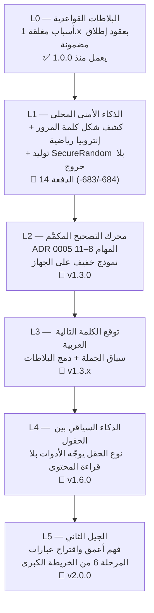

# خارطة الميزات الذكية — سلم الذكاء (SMART_FEATURES_ROADMAP.md)

> الوثيقة التنفيذية لذكاء DRS Smart Keyboard — تفصّل ما تبنيه الخريطة
> الكبرى ([ROADMAP](ROADMAP.md)) في محور «الذكاء على الجهاز» سلّمًا واحدًا
> قابلًا للفحص، من ذكاء البلاطات القواعدي اليوم إلى الجيل الثاني.
>
> **العقيدة الحاكمة للذكاء (لا تُخالف):**
> 1. **الذكاء يصمت حين لا يثق.** لا اقتراح بلا «عقد إطلاق مضمون» —
>    ما لا يُحلّ محليًا نتيجةً مؤكدة لا يُرشَّح أصلًا (ما لا يُفك لا يُرشَّح).
> 2. **لا تخمين ولا تلف.** كل أداة ذكية حتمية: ما لا يفهمه المحرك يعود
>    بايتًا ببايت — الذكاء توصية، والإطلاق بيد المستخدم وحده.
> 3. **كل الذكاء على الجهاز.** لا نموذج يُنزَّل من سحابة، لا محتوى حقل
>    يغادر الجهاز، ولا ذكاء إطلاقًا في حقول كلمات المرور أو الوضع
>    المطلق أو الوضع المتخفي (البوابة الصلبة في المحرر).
> 4. **سبب مغلق لكل ترشيح.** كل سبب يُرقَّم ويُوثَّق ويُختبر بالإيجاب
>    والسلب (نمط 1.9 → 1.12) — لا «ذكاء» بلا مرآة اختبار.

## سلم الذكاء L0 → L5

| المستوى | الثيمة | ما الذي يصبح ذكيًا؟ | أين يُقاس؟ |
|---|---|---|---|
| **L0** ✅ | البلاطات القواعدية | اللوحة تقترح الأداة الصحيحة من شكل النص — 12 سببًا مغلقًا بعقود إطلاق مختبرة إيجابًا وسلبًا | `DrsTileContextAdvisor` + اختباراته |
| **L1** 🚧 | الذكاء الأمني المحلي | الحقل يفهم أنه يحمل سرًا: قياس الإنتروبيا رياضيًا، كشف الأنماط الضعيفة بكتالوجات مغلقة، وتوليد كلمة قوية بـ`SecureRandom` — كلها بلا أي شبكة | `passwordStrength` / `generatePassword` |
| **L2** 📅 v1.3.0 | التصحيح المكمَّم | محرك تصحيح إملائي عربي بنموذج خفيف مكمَّم — ميزانيات حجم (< 15MB) وزمن معلنة في KPIs | ADR 0005 المهام 8–11 |
| **L3** 📅 v1.3.x | التوقع السياقي | توقع الكلمة التالية من سياق الجملة، ودمج توقعاته مع أسباب البلاطات دون كسر عقود الإطلاق | ADR 0005 المهام 12–14 |
| **L4** 📅 v1.6.0 | الذكاء بين الحقول | نوع الحقل (من `EditorInfo` وحده) يرتّب الأدوات — وحقول الحماية تبقى صماء تمامًا (الخصوصية قبل الذكاء دائمًا) | `DrsFieldKind` + `DrsContextualRank` |
| **L5** 📅 v2.0.0 | الجيل الثاني | فهم أعمق للسياق واقتراح عبارات كاملة — كلها مولَّدة محليًا | المرحلة 6 + ADR مستقل |

## المبادئ التنفيذية لكل مستوى (نمط الدفعة المثبت)

1. **محاكاة بايثون قبل البناء** — كل التوقعات تُحسب وتُختبر خارج Kotlin أولًا
   (`scripts/check_*.py`)، والمحاكاة هي المرجع حين تختلف عن التوقع اليدوي.
2. **عقد مضمون لكل ترشيح** — السبب الجديد في `DrsTileContextAdvisor` يُختبر
   إيجابًا (ما يُرشَّح ولماذا) وسلبًا (ما يصمت ولماذا) في `DrsSmartTileTests`.
3. **كتالوجات مغلقة موثقة** — لا قوائم مفتوحة ولا regex تقريبية: كل فئة
   (رموز، أنماط ضعيفة، فئات التباس) مكتالوجها الحرفي في الكود والتوثيق.
4. **فئة الالتباس المغلقة تُحسم بتوزيع الحكم** — الأداة تبقى شاملة على
   شكلها، والمستشار يصمت عنها (نمط الرقم المجرد «1250» في Hex والحساب).
5. **بوابة أخضر كاملة** — لا دفعة تُدفع قبل: بناء + اختبارات صفر فشل +
   Kover + التدقيق البنيوي + الأختام محدثة في كل ملفاتها.

## ذراع L1 — الدفعة 14 «الأمان الرقمي» (تُنفَّذ الآن)

| الأداة | الرمز | العقد المغلق |
|---|---|---|
| **قيس قوة كلمة المرور** | ‎-683 | قراءة فقط (توست لا تعديل): الموضوع المغلق — بلا مسافات وطوله 6..128 ولا يحمل رابطًا أو بريدًا — يُقاس رياضيًا: الإنتروبيا = الطول × log2(حجم المحارف الحاضرة) بكتالوجات مغلقة (26 صغيرة، 26 كبيرة، 10 أرقام، 28 عربية، 32 رمزًا) وحكم بخمس درجات <28/28/36/60/128 بت، وأنماط مقلقة بكتالوج مغلق (تسلسلات لوحة، تكرار، تواريخ، كلمات شائعة). الرقم المجرد يبقى رقمًا — الأداة شاملة والمستشار صامت |
| **مولّد كلمة مرور** | ‎-684 | إدراج عند المؤشر (التحديد النشط وحده يُستهلك إن وجد — وبقية الحقل لا يُمسّ أبدًا، عقد علامات الإدراج): 16 محرفًا من أبجدية مغلقة 68 محرفًا بلا متشابهات (l1IO0o)، وضمان صنف من كل فئة بالبناء، والإنتروبيا ≈ 97 بت. **بلا ترشيح آلي عمدًا** — جيل بضغطة واعية لا تخمينًا، ولا إطلاق إطلاقًا في حقول كلمات المرور |

**عقد الخصوصية للذراع:** لا شبكة إطلاقًا (canary يثبت)، لا تسجيل للمولَّد أو المقيس
(حلقة الأحداث تسجل النوع لا المحتوى)، والحقول المحمية تبقى مغلقة أمام السطح كله.

## مؤشرات الذكاء (تُراجع مع كل مستوى)

| المؤشر | خط الأساس | الهدف |
|---|---|---|
| أسباب البلاطات المغلقة المختبرة | 12 سببًا (L0) | +1 مع كل دفعة ذكية، اختبار إيجاب/سلب لكل سبب |
| إنذارات كاذبة في الترشيح | قيد القياس بالاختبارات | صفر إيجاب كاذب في مجموعات الاختبار المغلقة |
| زمن قرار الترشيح | حراس طول مغلقة (256/64/128) | < 1ms دائمًا — المسار الساخن رخيص |
| حجم نموذج التصحيح (L2) | — | < 15MB وأثر ذاكرة محدود ومعلن |
| تسريب شبكي للذكاء | صفر بنيويًا | صفر دائمًا — privacy canary كل دفعة |

## الحوكمة

- كل مستوى L جديد يفتح بقرار ADR (L2/L3 لهما ADR 0005، L5 بقراره المستقل).
- هذا السلّم يُحدَّث مع كل دفعة ذكية: علامة ✅/🚧/📅 تتحرك، ولا يُعلن
  مستوى «مكتملًا» قبل اجتياز مؤشراته في الجدول أعلاه.
- أي ميزة ذكية لا تنطبق عليها العقيدة الأربع لا تدخل السلّم مهما كان
  جاذبيتها — الهوية قبل الميزة.
